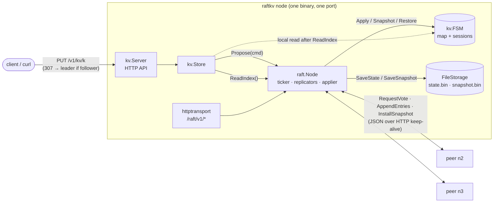
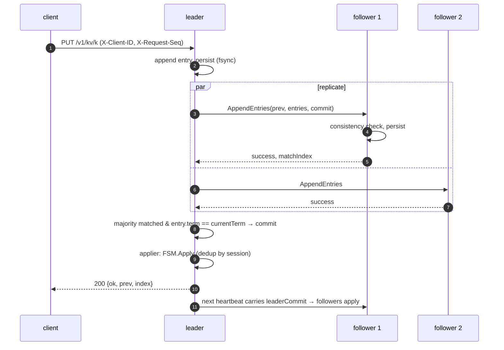
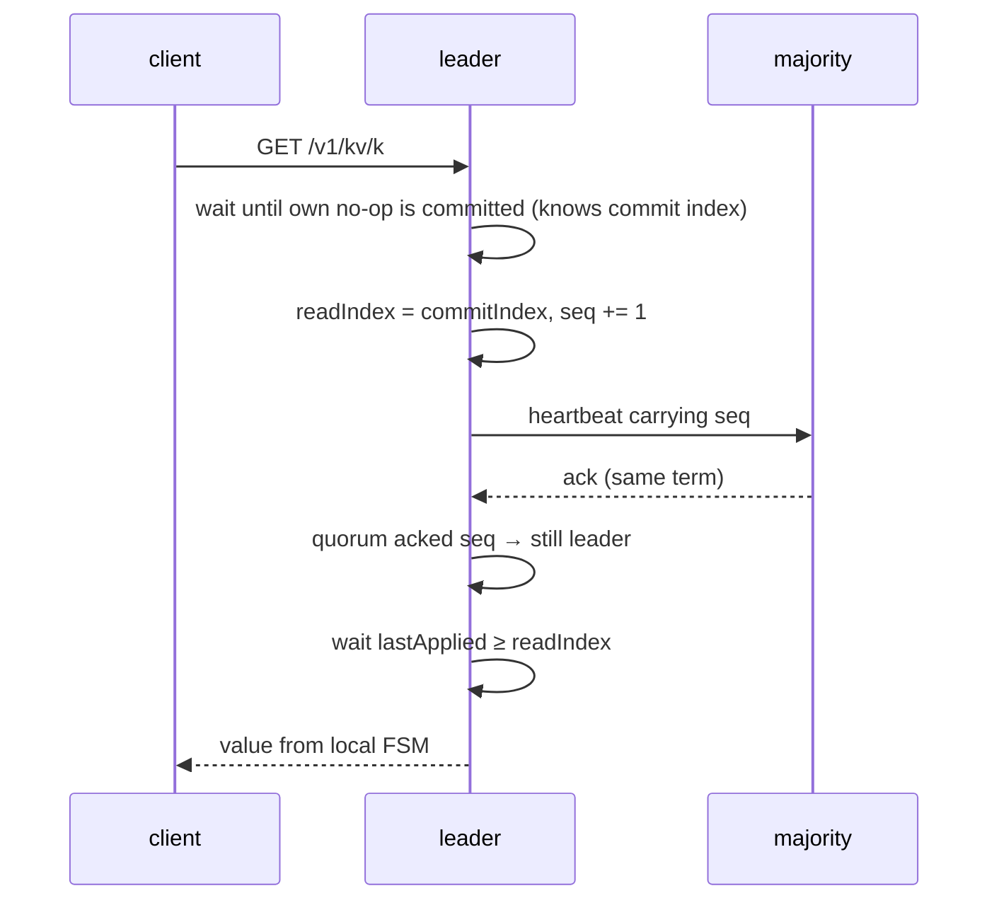
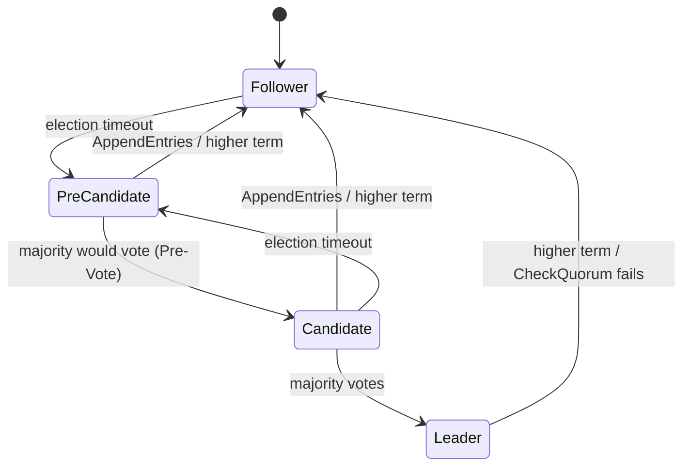

# raft-kv

[](https://github.com/HOFFMAN-ALTERNATIVE/raft-kv/actions/workflows/ci.yml)


-2EA44F)
[](LICENSE)

A **replicated, linearizable key-value store** built on a **from-scratch
implementation of the Raft consensus algorithm** in Go — no `hashicorp/raft`,
no `etcd/raft`. One dependency, and it's only used by the tests
(`porcupine`, a linearizability checker).

It goes beyond the textbook Figure 2 with the pieces a real deployment needs:

| Feature | Why it matters |
|---|---|
| **Leader election** with randomised timeouts | liveness without coordination |
| **Pre-Vote** (thesis §9.6) | a node coming back from a partition can't depose a healthy leader by inflating its term |
| **CheckQuorum** | a leader cut off from the majority steps down on its own instead of silently accepting writes it can never commit |
| **Log replication** with fast conflict backtracking | followers return `(ConflictTerm, ConflictIndex)`, so repairing a divergent log costs one round trip per term, not per entry |
| **ReadIndex linearizable reads** (thesis §6.4) | reads don't go through the log, yet can never return stale data — proven by the checker below |
| **Snapshots + log compaction + InstallSnapshot** | bounded log size; lagging or new followers catch up from a snapshot |
| **Exactly-once client sessions** (thesis §6.3) | a retried write after a leader crash is applied at most once |
| **Crash-safe file storage** | write-temp → fsync → rename → fsync(dir) |
| **HTTP API** with leader redirects (307), stale-read option, CAS, Prometheus `/metrics` | plain `curl` works against any node |
| **Fault-injection network** for tests | partitions, message loss, delays, reordering, crashes |

## Architecture



Inside `raft.Node` everything is guarded by one mutex; three kinds of
goroutines do the work:

- **ticker** — fires elections (Pre-Vote first) and runs CheckQuorum on the leader;
- **one replicator per peer** — heartbeats on a timer, ships entries or a
  snapshot as soon as it's triggered, one RPC in flight per peer;
- **applier** — the *only* goroutine that touches the state machine: applies
  committed entries in order, restores installed snapshots, takes local
  snapshots. That single-writer rule is what lets `Snapshot()` run without
  stopping the world.

### Write path



### Linearizable read path (ReadIndex)



### Roles



## How it's tested

Correctness of a consensus implementation is only as good as its tests, so
most of the code here *is* tests.

| Test | What it proves |
|---|---|
| **Global apply checker** (every raft test) | the harness records every `(index, command)` any node applies and fails the moment two nodes disagree — *State Machine Safety* is checked continuously, not just at the end |
| `TestInitialElection` | one leader, no spurious elections when nothing fails |
| `TestReElection` | failover on leader loss; isolated old leader steps down (CheckQuorum); rejoin doesn't change term (Pre-Vote); no leader without quorum |
| `TestPreVoteIsolatedFollowerDoesNotInflateTerm` | an isolated node sits through 10 election timeouts with an unchanged term |
| `TestNoCommitWithoutMajorityAndDivergentLogRepair` | a minority leader can't commit; its uncommitted suffix is overwritten after heal |
| `TestPersistenceAcrossFullRestart`, `TestLeaderCrashLoop` | crash/restart from storage, full history replayed |
| `TestSnapshotInstallForLaggingFollower` | follower catches up via InstallSnapshot, every log stays bounded, restart restores from snapshot |
| `TestReadIndex` | followers refuse; a partitioned leader can't serve a linearizable read even before it notices |
| `TestChaosUnreliableNetwork` | 5 nodes, 4 concurrent writers, 10 % message loss + delays + reordering, random crashes and partitions for 6 s, then must converge |
| **`TestLinearizableUnderPartitions`** | 6 clients run ~900 get/put/CAS operations against 5 nodes under rolling partitions on a lossy network; the full real-time history is checked with [porcupine](https://github.com/anishathalye/porcupine) |
| `TestModelRejectsStaleRead` | negative control for the checker model |
| `TestHTTPAPIEndToEnd` | 3 real HTTP servers: redirects, CAS 409, deletes, sessions, snapshots, metrics |
| **CI `chaos` job** | real 3-container cluster: SIGKILL the leader, check no acked write is lost, restart it, `docker network disconnect` a follower, keep committing on the majority, heal, verify catch-up |

The checker isn't decorative: switching the test's reads from `Linearizable`
to `Stale` makes porcupine report the history as **Illegal** within one run.

Everything runs with `-race` on Go 1.23, 1.24 and stable in CI.

## Quick start

```bash
docker compose up -d --build          # n1, n2, n3 on localhost:7001-7003

curl -L -X PUT localhost:7002/v1/kv/greeting -d 'hello'   # follower → 307 → leader
curl -s localhost:7001/v1/kv/greeting                       # linearizable read
curl -s 'localhost:7003/v1/kv/greeting?consistency=stale'   # local, may lag
curl -s localhost:7001/v1/status | jq

./scripts/chaos.sh                     # kill the leader, partition a follower, verify
```

Without Docker:

```bash
make build
P=n1=http://127.0.0.1:7001,n2=http://127.0.0.1:7002,n3=http://127.0.0.1:7003
for i in 1 2 3; do ./bin/raftkv -id n$i -listen 127.0.0.1:700$i -peers $P -data /tmp/raftkv/n$i & done
```

## HTTP API

| Method & path | Description |
|---|---|
| `GET /v1/kv/{key}` | linearizable read (ReadIndex). `?consistency=stale` serves local state on any node. `404` if absent |
| `PUT /v1/kv/{key}` | body = value (≤ 1 MiB) |
| `DELETE /v1/kv/{key}` | `404` if absent |
| `POST /v1/cas/{key}` | `{"expected": "old" \| null, "value": "new"}` — `null` means "create if absent"; `409` on mismatch |
| `GET /v1/keys?prefix=&limit=` | sorted keys (local state) |
| `GET /v1/status` | role, term, leader, commit/applied/snapshot indexes, counters |
| `GET /metrics` | Prometheus text format (`raft_term`, `raft_is_leader`, `raft_commit_index`, …) |
| `GET /healthz`, `GET /readyz` | liveness; readiness = a leader is known |

Keys may contain `/`. Writes and linearizable reads on a follower return
`307 Temporary Redirect` to the leader (`curl -L` follows it with method and
body intact); with no leader the answer is `503` + `Retry-After`.

**Exactly-once retries:** send `X-Client-ID: <uuid>` and a monotonically
increasing `X-Request-Seq`. If a write times out (`503 {"outcome":"unknown"}`),
retry it with the *same* seq — the state machine returns the original result
instead of applying it twice. Sessions are part of snapshots.

## Configuration

| Flag | Env | Default |
|---|---|---|
| `-id` | `RAFTKV_ID` | — |
| `-peers` | `RAFTKV_PEERS` | — (`id=url,…`, includes self; used for Raft RPCs) |
| `-client-urls` | `RAFTKV_CLIENT_URLS` | `-peers` (`id=url,…` advertised in 307 redirects, for NAT / port mapping) |
| `-listen` | `RAFTKV_LISTEN` | `:7001` |
| `-data` | `RAFTKV_DATA` | `./data` |
| `-election-timeout` | | `500ms` (randomised to [T, 2T)) |
| `-heartbeat` | | `100ms` |
| `-snapshot-threshold` | | `1000` entries |
| `-log-level` | | `info` (JSON logs via `log/slog`) |

## Design decisions

- **From scratch, library-shaped.** `raft` knows nothing about keys or HTTP:
  it takes a `Transport`, a `Storage` and a `StateMachine`. The KV store is
  ~430 lines on top. The same core runs over HTTP in production and over the
  in-memory fault-injection network in tests.
- **One mutex, not channels everywhere.** Raft's state is a single tightly
  coupled invariant set (term, vote, log, commit index). A single lock with
  condition variables is easier to reason about — and to verify with `-race`
  — than an actor loop plus a dozen channels. Blocking work (RPCs, FSM
  apply, fsync of snapshots) always happens with the lock released.
- **Pre-Vote + CheckQuorum together.** Pre-Vote alone stops term inflation
  but a partitioned leader would keep believing it leads; CheckQuorum makes
  it step down. Pre-Vote also implements *leader stickiness*: nodes that
  heard from a leader within the election timeout refuse to pre-vote.
- **ReadIndex instead of reads-through-the-log or leases.** Log reads cost a
  disk write per read; leader leases depend on bounded clock drift. ReadIndex
  costs one heartbeat round and relies on nothing but quorum. Heartbeats
  carry a sequence number, so one round can confirm many concurrent reads.
- **Commit only current-term entries by counting** (§5.4.2) — earlier-term
  entries are committed indirectly. Every leader appends a no-op on election
  so this happens immediately and ReadIndex knows the true commit index.
- **"Outcome unknown" is a first-class error.** `Propose` returns
  `ErrLeadershipLost` / a context error when it can't know whether the entry
  will commit; the HTTP layer surfaces it as `503 outcome: unknown` and the
  session table makes the retry safe.
- **Snapshots are written before the compacted state.** A crash in between
  leaves a snapshot newer than the log base, which recovery detects and
  trims; the reverse (log base pointing at a snapshot that doesn't exist) is
  impossible by construction.
- **Fail-stop on storage errors.** If persisting a vote or entry fails,
  continuing could double-vote; the node panics instead.
- **JSON over HTTP for RPCs.** Debuggable with `curl` and `tcpdump`, no code
  generation, and one listener for everything. gRPC/protobuf would cut
  serialisation cost; the `Transport` interface is the seam for that.

## Non-goals / limitations

Kept out deliberately to keep the core auditable; each would slot in behind
the existing interfaces:

- **Static membership** — no joint consensus / single-server changes yet.
- **Whole-state persistence** — the log is re-encoded on each change; it's
  bounded by the snapshot threshold, but a segmented WAL with group commit
  would be the production storage engine.
- **One RPC in flight per peer**, snapshots sent in a single message — no
  pipelining or chunked/streamed InstallSnapshot.
- No TLS/auth on the peer port — run it on a private network or behind mTLS.

## Layout

```
raft/                 consensus core (node.go, types.go, storage.go)
raft/memnet/          fault-injecting in-memory network for tests
raft/httptransport/   JSON-over-HTTP transport + RPC handlers
kv/                   state machine, sessions, Store, HTTP API
cmd/raftkv/           the binary
scripts/chaos.sh      docker-compose fault injection (used by CI)
```

```bash
make race    # all tests with the race detector
make bench   # BenchmarkPropose3Nodes (in-memory, ~0.25 ms/commit on 8 vCPU)
make lint
```

## References

- D. Ongaro, J. Ousterhout — *In Search of an Understandable Consensus Algorithm* (2014)
- D. Ongaro — *Consensus: Bridging Theory and Practice* (PhD thesis, 2014): Pre-Vote §9.6, ReadIndex §6.4, client sessions §6.3
- A. Athalye — *porcupine*, a fast linearizability checker

## License

[MIT](LICENSE) © 2026 Herman Hoffman
